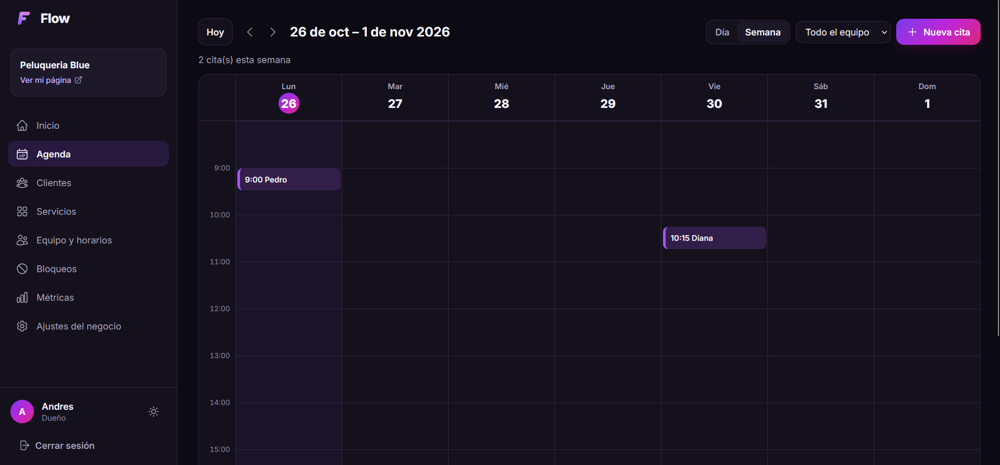
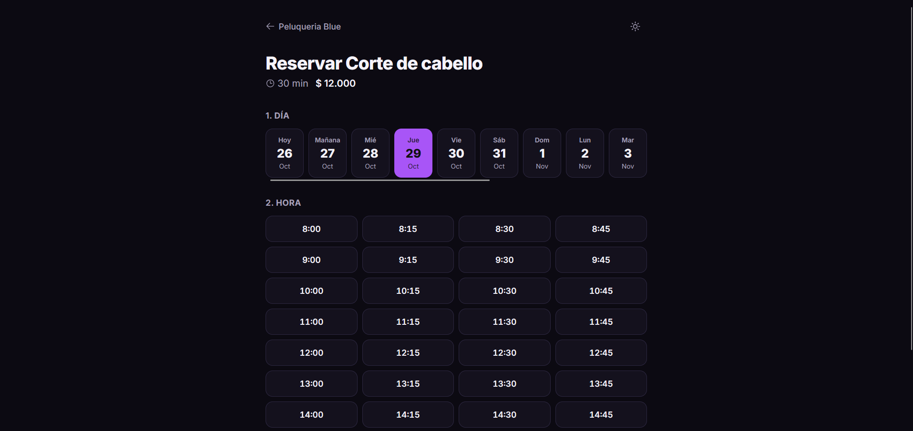
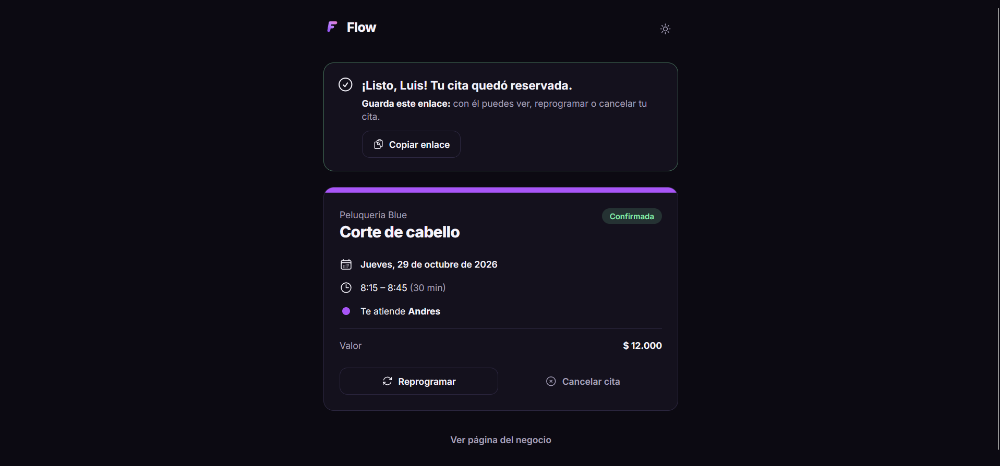
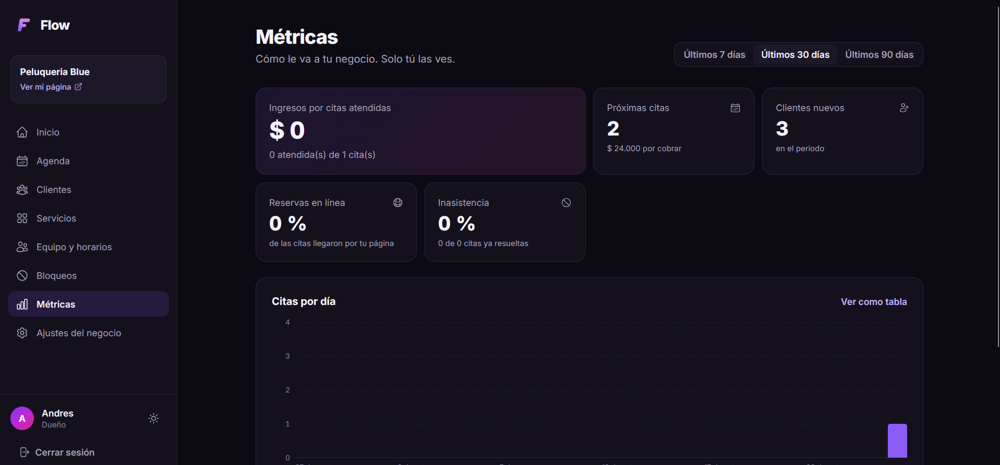
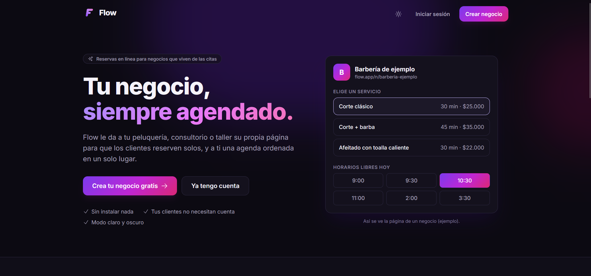
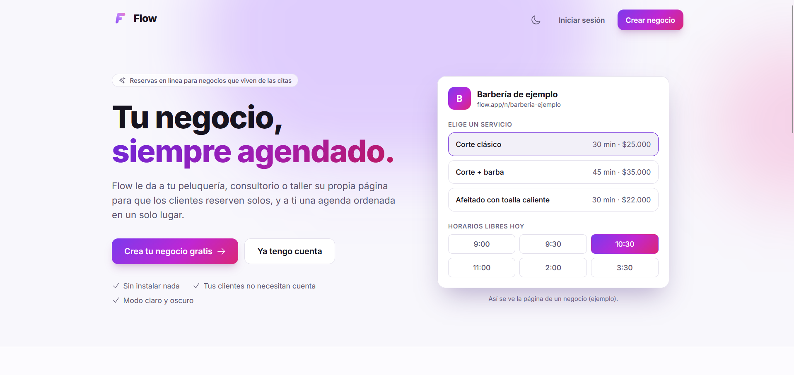
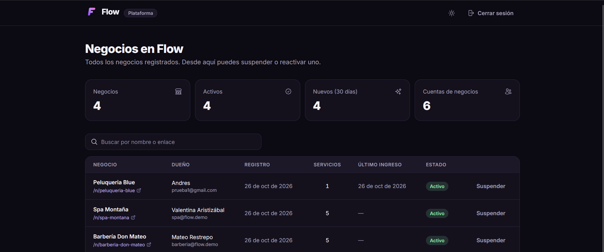

# Flow

[](https://github.com/yexg08/Flow/actions/workflows/ci.yml)
[](LICENSE)


**[English](README.md)** · Español

**Reservas en línea para negocios que viven de las citas.** Flow es un SaaS multi-negocio: cada negocio (peluquería,
consultorio, taller…) tiene su propio panel y su propia página pública de reservas, y sus datos quedan completamente
aislados de los demás negocios.

> Proyecto de portafolio. "Flow" es un nombre provisional. La interfaz está en español (Colombia).

## Capturas

| | |
|---|---|
|  |  |
| **Agenda semanal** del negocio, por día o semana y por miembro del equipo | **Reserva pública** sin cuenta: día y hora |
|  |  |
| **Reserva confirmada**, con un enlace privado para reprogramar o cancelar | **Métricas** del negocio (solo el dueño) |
|  |  |
| **Página de inicio**, tema oscuro | **Página de inicio**, tema claro |
|  | |
| **Panel del superadmin**: todos los negocios, suspender o reactivar | |

## Probarlo con Docker

Solo necesitas [Docker Desktop](https://www.docker.com/products/docker-desktop/): levanta la base de datos, la API y el
frontend con un solo comando, sin instalar .NET ni Node.

```bash
# 1. Crea tu archivo .env con claves aleatorias (no se sube a Git)
cat > .env <<EOF
JWT_KEY=$(openssl rand -hex 32)
LINKS_KEY=$(openssl rand -hex 32)
SUPERADMIN_PASSWORD=Admin1$(openssl rand -hex 6)
DEMO_DATA=true
DEMO_PASSWORD=Demo1$(openssl rand -hex 6)
EOF

# 2. Construye y arranca todo
docker compose --profile app up --build
```

<details>
<summary>En PowerShell (Windows) el paso 1 es así</summary>

```powershell
function New-Secret { $b = New-Object byte[] 32; [Security.Cryptography.RandomNumberGenerator]::Create().GetBytes($b); -join ($b | ForEach-Object { $_.ToString('x2') }) }
@"
JWT_KEY=$(New-Secret)
LINKS_KEY=$(New-Secret)
SUPERADMIN_PASSWORD=Admin1$((New-Secret).Substring(0, 12))
DEMO_DATA=true
DEMO_PASSWORD=Demo1$((New-Secret).Substring(0, 12))
"@ | Set-Content .env -Encoding ascii
```

</details>

Abre http://localhost:8080 (usa Chrome, Edge o Firefox: Safari no guarda cookies `Secure` por http). Las contraseñas
están en tu archivo `.env`. Con `DEMO_DATA=true` se cargan dos negocios de Manizales con equipo, clientes y citas de las
últimas semanas y las próximas (las fechas se calculan desde hoy, así la agenda nunca se ve vacía):

| Cuenta | Correo | Contraseña |
|---|---|---|
| Dueño de la barbería | `barberia@flow.demo` | `DEMO_PASSWORD` |
| Empleado de la barbería | `empleado.barberia@flow.demo` | `DEMO_PASSWORD` |
| Dueña del spa | `spa@flow.demo` | `DEMO_PASSWORD` |
| Empleada del spa | `empleado.spa@flow.demo` | `DEMO_PASSWORD` |
| Superadmin de la plataforma | `admin@flow.local` | `SUPERADMIN_PASSWORD` |

La página pública de cada negocio está en `/n/barberia-don-mateo` y `/n/spa-montana`. Para empezar de cero:
`docker compose --profile app down -v`.

## Stack

| Capa | Tecnología |
|---|---|
| Backend | .NET 10, ASP.NET Core, EF Core 10, ASP.NET Identity, FluentValidation |
| Base de datos | PostgreSQL 17 (Docker) |
| Frontend | Angular 22 (zoneless, standalone, signals, `httpResource`), Tailwind CSS v4, Angular CDK, Heroicons |
| Pruebas | xUnit + `WebApplicationFactory` + **Testcontainers** (PostgreSQL real) · Vitest |
| Infraestructura | Docker (imagen única: la API sirve el frontend compilado) · GitHub Actions · Dependabot |

## Estado

| Fase | Contenido | Estado |
|---|---|---|
| 1 | Base: registro de negocios, login, aislamiento multi-negocio, superadmin, servicios, página pública | Hecha |
| 2 | Equipo, horarios semanales y bloqueos | Hecha |
| 3 | Reserva pública: horarios disponibles, reservar sin cuenta, cancelar/reprogramar | Hecha |
| 4 | Agenda del negocio (día/semana), estados de cita, clientes | Hecha |
| 5 | Cuentas del equipo, métricas, avisos por WhatsApp | Hecha |
| 6 | Pulido del repositorio: Docker completo, CI, datos de ejemplo, README | Hecha |
| Después | Módulo de pedidos para restaurantes (menú por QR) | Pendiente |

## Cómo funciona el multi-negocio

Una sola base de datos y un solo esquema: **cada dato de un negocio lleva su `TenantId`**. El aislamiento tiene tres
barreras, y cada una tiene pruebas:

1. **El negocio sale de la base de datos, nunca del cliente.** En cada petición, `SessionValidator`
   (`Api/Auth/SessionValidator.cs`) revisa la cuenta en la base y agrega el `TenantId` a la sesión. Un token
   fabricado con otro `tenant_id` no sirve: ese claim se descarta y se reconstruye. Si el negocio se suspende o la
   cuenta se desactiva, la sesión se corta **en la siguiente petición**, sin esperar a que venza el token.
2. **Filtro global de lectura** (`Infrastructure/Persistence/AppDbContext.cs`): toda entidad que implemente
   `ITenantOwned` se filtra automáticamente por el negocio de la sesión, incluidas las que se agreguen en el futuro.
   Pedir por id un dato de otro negocio da **404**, igual que un id inventado. Sin negocio en la sesión (superadmin o
   anónimo), el filtro no deja pasar **ninguna** fila.
3. **Interceptor de escritura** (`TenantInterceptor`): al crear un dato le pone el `TenantId` de la sesión (lo que
   venga en la petición se ignora), y rechaza modificar o borrar datos de otro negocio, aunque un error de código los
   hubiera cargado saltándose el filtro.

La **página pública** (`/n/{slug}`) es el único lugar que lee datos de negocio sin sesión: ignora el filtro de forma
explícita, filtra a mano por el negocio del enlace y usa DTOs propios con solo los campos pensados para el público.

### Equipo, horarios y bloqueos

- El **equipo** son las personas que atienden (no son cuentas de usuario): nombre, color en la agenda y los
  servicios que hace. Solo se le pueden asignar servicios del propio negocio.
- El **horario semanal** admite varios tramos por día (mañana y tarde). Las reglas (formato `HH:mm`, pasos de 5
  minutos, cierre después de la apertura, sin tramos que se crucen) están en `Application/Team/Schedule.cs` y se
  repiten en el frontend (`shared/schedule.ts`) para guiar al usuario; la base además tiene una restricción `CHECK`.
- Los **bloqueos** son de una persona o de todo el negocio (un festivo). Se escriben y se muestran en la **hora local
  del negocio** y se guardan en UTC según su zona horaria. Las horas que no existen por el cambio de horario se
  rechazan.
- Borrar un servicio lo quita de quienes lo hacían; borrar a una persona borra su horario y sus bloqueos (en cascada
  en la base de datos).

### Reservas

- **Horarios libres** (`Application/Booking/AvailabilityEngine.cs`): cada 15 minutos dentro de los tramos del horario
  donde cabe el servicio completo, sin cruzarse con otras citas ni con bloqueos, con al menos 15 minutos de
  anticipación y hasta 60 días adelante. Todo se calcula en la zona horaria del negocio.
- **Reservar sin cuenta**: nombre, celular y autorización expresa del uso de los datos (Ley 1581). El cliente queda
  identificado por su celular dentro de cada negocio, con máximo 3 citas próximas por celular. Con "cualquier
  persona", la cita va a quien tenga menos citas ese día.
- **El servidor nunca confía en el navegador**: al reservar vuelve a calcular el horario y toma el precio de la base.
- **Sin dobles reservas, ni siquiera simultáneas**: además de la validación de la app, PostgreSQL tiene una
  restricción de exclusión (`EXCLUDE USING gist`, con `btree_gist`) que impide dos citas activas de la misma persona
  con rangos cruzados. Una prueba lanza 8 reservas al mismo tiempo por el mismo horario y solo una entra; sin la
  restricción, entran las 8.
- **Enlace privado para gestionar la cita** (`/cita/{token}`): ver, reprogramar o cancelar. El token tiene 256 bits y
  en la base solo se guarda su SHA-256. Es la única consulta que busca entre todos los negocios; después se fija el
  negocio de esa cita y todo lo demás pasa por el filtro normal. La página usa `Referrer-Policy: no-referrer` para que
  el token no viaje a otros sitios.
- Un servicio o una persona con citas no se puede borrar (se desactiva), para no perder el historial.

### Agenda y clientes

- **Agenda por día** (una columna por persona) **y por semana** (con filtro por persona), con los bloqueos sombreados
  y la hora actual marcada. Las citas que se cruzan se dibujan lado a lado (`shared/agenda-layout.ts`, con pruebas).
- **Agendar desde el panel** (llamadas, clientes que llegan en persona): se puede fuera del horario del equipo, porque
  lo decide el negocio, pero nunca encima de otra cita de la misma persona ni durante un bloqueo.
- **Estados**: confirmada → atendida o no asistió (solo cuando ya empezó) o cancelada. Todo se puede deshacer;
  reactivar una cancelada exige que el horario siga libre.
- **Clientes**: búsqueda por nombre o celular, visitas, inasistencias, próxima cita, historial completo y notas
  internas que el cliente no ve.

### Equipo con acceso, métricas y avisos

- **Cuentas del equipo**: el dueño le da acceso al panel a una persona del equipo con su correo. El sistema genera
  una contraseña temporal (16 caracteres, sin caracteres que se confundan) que se ve **una sola vez**, vence a los
  **7 días** y obliga a cambiarla en el primer ingreso: mientras tanto la cuenta solo puede usar el cambio de
  contraseña (lo aplica la API, no solo la pantalla). Generar otra o quitar el acceso corta sus sesiones al instante.
  Borrar a la persona borra también su cuenta, o nada si la persona tiene citas.
- **Métricas** (solo el dueño): ingresos de las citas atendidas, próximas citas y lo que falta por cobrar, clientes
  nuevos, porcentaje de reservas en línea, tasa de inasistencia, citas por día, servicios más pedidos y citas por
  persona. La gráfica tiene vista de tabla y su color está validado para ambos temas.
- **Avisos por WhatsApp**: desde el detalle de una cita, confirmación o recordatorio en un clic con enlaces `wa.me`
  (sin costo ni API de pago), con el enlace privado de la cita incluido.
- **Enlaces de cita reconstruibles**: el token es `HMAC-SHA256(Links:Key, id de la cita)`, así el negocio puede volver
  a enviarlo cuando quiera sin guardarlo; en la base solo está su hash.

### Roles

| Rol | Qué puede usar |
|---|---|
| **Superadmin** | Panel de la plataforma (`/admin`): todos los negocios, suspender/reactivar. No ve datos internos de los negocios. |
| **Dueño** | Todo el panel de su negocio, incluidos servicios y ajustes. |
| **Empleado** | Agenda, clientes y marcar asistencia. No puede cambiar servicios, equipo ni ajustes, ni ver métricas. |
| Cliente final | No tiene cuenta: usa la página pública del negocio. |

**Denegar por defecto:** la política de respaldo de ASP.NET exige ser miembro de un negocio. Un endpoint nuevo sin
atributos nunca queda abierto al público ni al superadmin por olvido (`Api/Auth/Policies.cs`). `AuthorizationTests`
recorre **todos** los endpoints de la API con cada rol para comprobarlo.

### Otras medidas de seguridad

- Contraseñas con hash (Identity); bloqueo de 15 minutos tras 5 intentos fallidos; límite de peticiones por IP en
  login, registro, disponibilidad de enlace y páginas públicas.
- El login responde igual y tarda lo mismo con un correo inexistente (no se puede averiguar qué correos tienen cuenta).
- Access token JWT de 15 minutos solo en memoria del navegador; refresh token de 7 días en cookie `httpOnly`,
  `Secure`, `SameSite=Strict`, rotado en cada uso. Reusar un refresh token ya rotado cierra todas las sesiones del
  usuario.
- Cabeceras de seguridad (CSP, `nosniff`, `X-Frame-Options`…) en todas las respuestas, HSTS fuera de desarrollo,
  peticiones de máximo 1 MB.
- Búsquedas del superadmin con los comodines de `LIKE` escapados.

## Desarrollo local

Para desarrollar (con recarga en caliente) en vez de usar la imagen de Docker.

### Requisitos

- [.NET 10 SDK](https://dotnet.microsoft.com/download)
- [Node.js](https://nodejs.org/) 24+
- [Docker Desktop](https://www.docker.com/products/docker-desktop/) (base de datos y pruebas del backend)

### Primera vez

```bash
# 1. Base de datos (PostgreSQL en el puerto 5434)
docker compose up -d

# 2. Contraseña del superadmin (la clave JWT ya está configurada en user-secrets)
cd backend/src/Flow.Api
dotnet user-secrets set "Seed:SuperAdminPassword" "<mínimo 10 caracteres, con letras y números>"
#    Si clonaste el repo en otro equipo, genera también las dos claves (mínimo 32 caracteres cada una, distintas):
#    dotnet user-secrets set "Jwt:Key" "<texto aleatorio largo>"
#    dotnet user-secrets set "Links:Key" "<otro texto aleatorio largo>"
#    Sin ellas la API no arranca. Cambiar Links:Key invalida todos los enlaces de cita ya enviados.

# 3. Dependencias del frontend
cd ../../../frontend
npm install
```

El superadmin se crea al arrancar la API con el correo de `appsettings.json` (`admin@flow.local`) y la contraseña
de user-secrets. Las migraciones se aplican solas al arrancar.

Datos de ejemplo (opcional, los mismos dos negocios de la sección de Docker):

```bash
cd backend/src/Flow.Api
dotnet user-secrets set "Seed:DemoData" "true"
dotnet user-secrets set "Seed:DemoPassword" "<mínimo 10 caracteres, con letras y números>"
```

No se repiten: si los negocios de ejemplo ya existen, se omiten.

### Uso diario

```bash
# Terminal 1: API (http://localhost:5090)
cd backend/src/Flow.Api
dotnet run

# Terminal 2: frontend (http://localhost:4300)
cd frontend
npm start
```

El frontend llama a `/api` y el proxy de Angular (`proxy.conf.json`) lo reenvía a la API: todo queda en el mismo
origen y no hace falta CORS.

| Ruta | Pantalla |
|---|---|
| `/` | Página de inicio de Flow |
| `/registro` | Crear un negocio (registro abierto) |
| `/login` | Iniciar sesión |
| `/app` | Panel del negocio: inicio, agenda, clientes, servicios, equipo y horarios, bloqueos, métricas, ajustes |
| `/cambiar-contrasena` | Primer ingreso de un empleado con contraseña temporal |
| `/admin` | Panel de la plataforma (superadmin) |
| `/n/{enlace}` | Página pública de un negocio |
| `/n/{enlace}/reservar/{servicio}` | Reservar: persona, día, hora y datos |
| `/cita/{token}` | La cita del cliente: ver, reprogramar o cancelar |

## Pruebas

```bash
# Backend: necesita Docker encendido (Testcontainers levanta un PostgreSQL desechable)
cd backend
dotnet test

# Frontend
cd frontend
npx ng test --watch=false
```

**GitHub Actions** (`.github/workflows/ci.yml`) corre en cada push y pull request:

- compilación y pruebas del backend (con Testcontainers) y del frontend;
- auditoría de dependencias: paquetes NuGet y npm con vulnerabilidades conocidas hacen fallar la ejecución;
- construcción de la imagen de Docker y una **prueba de humo** de la app completa: arranca con `docker compose`,
  comprueba el frontend, las cabeceras de seguridad, que `/api` exija sesión y que el login de ejemplo funcione.

Dependabot propone las actualizaciones semanales de NuGet, npm, GitHub Actions y Docker.

## Estructura

```
backend/
  src/
    Flow.Domain/          Entidades (Tenant, BookableService…) e ITenantOwned
    Flow.Application/     Casos de uso, DTOs, validaciones, reglas del enlace (Slugs)
    Flow.Infrastructure/  EF Core + Identity, filtro e interceptor de negocio, auth, migraciones, datos de ejemplo
    Flow.Api/             Controladores, políticas, validación de sesión, cabeceras, límites, frontend compilado
  tests/Flow.Tests/       Integración contra PostgreSQL real + unitarias
frontend/
  src/app/
    core/                 Sesión, interceptores, guards, tema, avisos
    shared/               Logo, diálogo de confirmación, formatos, reglas del enlace
    features/             landing, auth, app (panel del negocio), admin, public
Dockerfile                Imagen única (compila el frontend y la API y los junta)
docker-compose.yml        Base de datos; con --profile app también la app completa
.github/                  CI (GitHub Actions) y Dependabot
```

## Crear una migración

```bash
cd backend
dotnet ef migrations add NombreDeLaMigracion --project src/Flow.Infrastructure --startup-project src/Flow.Infrastructure --output-dir Persistence/Migrations
```

## Licencia

[MIT](LICENSE)
