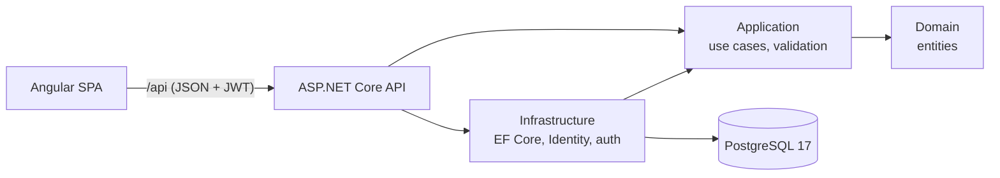
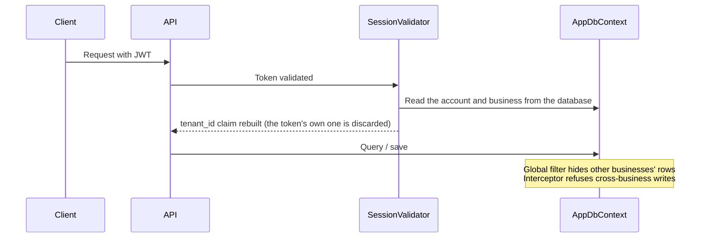

# Flow

[](https://github.com/yexg08/Flow/actions/workflows/ci.yml)
[](LICENSE)


English · **[Español](README.es.md)**

**Online booking for businesses that live on appointments.** Flow is a multi-tenant SaaS: every business (barbershop,
clinic, workshop…) gets its own dashboard and its own public booking page, and its data is completely isolated from
every other business.

> Portfolio project. "Flow" is a working name. The UI is in Spanish (Colombia).

## Screenshots

| | |
|---|---|
|  |  |
| **Weekly agenda** of the business, by day or week and by team member | **Public booking** with no account: day and time |
|  |  |
| **Booking confirmed**, with a private link to reschedule or cancel | **Business metrics** (owner only) |
|  |  |
| **Landing page**, dark theme | **Landing page**, light theme |
|  | |
| **Superadmin panel**: every business, suspend or reactivate | |

## What is interesting about it

- **Tenant isolation enforced in three layers, with tests that fail if any of them is removed.** The business comes
  from the database, never from the client; a global EF Core query filter hides other businesses' rows; a save
  interceptor refuses to write them. [How it works](#how-multi-tenancy-works)
- **No double bookings, not even under concurrency.** A PostgreSQL exclusion constraint makes overlapping
  appointments impossible; a test fires 8 simultaneous bookings for the same slot and exactly one succeeds. Without
  the constraint, all 8 get in. [Details](#bookings)
- **Time zones done properly.** Everything is stored in UTC and computed in the business's own time zone, and local
  times that do not exist because of a daylight-saving jump are rejected.
- **Reusable private links without storing secrets.** The link a customer receives is an HMAC of the appointment id,
  so the business can resend it any time while the database keeps only its hash.
- **Deny by default.** A test walks *every* API endpoint with every role to prove nobody reaches anything that is
  not theirs, including endpoints added in the future.
- **One-command run**, CI with dependency audit and a smoke test of the full Docker image.

## Try it with Docker

You only need [Docker Desktop](https://www.docker.com/products/docker-desktop/): one command starts the database, the
API and the frontend, with no .NET or Node installed.

```bash
# 1. Create your .env file with random secrets (it is not committed)
cat > .env <<EOF
JWT_KEY=$(openssl rand -hex 32)
LINKS_KEY=$(openssl rand -hex 32)
SUPERADMIN_PASSWORD=Admin1$(openssl rand -hex 6)
DEMO_DATA=true
DEMO_PASSWORD=Demo1$(openssl rand -hex 6)
EOF

# 2. Build and start everything
docker compose --profile app up --build
```

<details>
<summary>On PowerShell (Windows), step 1 looks like this</summary>

```powershell
function New-Secret { $b = New-Object byte[] 32; [Security.Cryptography.RandomNumberGenerator]::Create().GetBytes($b); -join ($b | ForEach-Object { $_.ToString('x2') }) }
@"
JWT_KEY=$(New-Secret)
LINKS_KEY=$(New-Secret)
SUPERADMIN_PASSWORD=Admin1$((New-Secret).Substring(0, 12))
DEMO_DATA=true
DEMO_PASSWORD=Demo1$((New-Secret).Substring(0, 12))
"@ | Set-Content .env -Encoding ascii
```

</details>

Open http://localhost:8080 (use Chrome, Edge or Firefox: Safari does not store `Secure` cookies over http). The
passwords are in your `.env` file. With `DEMO_DATA=true` two businesses from Manizales are loaded, with staff,
customers and appointments for the past weeks and the next one (dates are computed from today, so the agenda is never
empty):

| Account | Email | Password |
|---|---|---|
| Barbershop owner | `barberia@flow.demo` | `DEMO_PASSWORD` |
| Barbershop employee | `empleado.barberia@flow.demo` | `DEMO_PASSWORD` |
| Spa owner | `spa@flow.demo` | `DEMO_PASSWORD` |
| Spa employee | `empleado.spa@flow.demo` | `DEMO_PASSWORD` |
| Platform superadmin | `admin@flow.local` | `SUPERADMIN_PASSWORD` |

Each business has its public page at `/n/barberia-don-mateo` and `/n/spa-montana`. To start over:
`docker compose --profile app down -v`.

## Stack

| Layer | Technology |
|---|---|
| Backend | .NET 10, ASP.NET Core, EF Core 10, ASP.NET Identity, FluentValidation |
| Database | PostgreSQL 17 |
| Frontend | Angular 22 (zoneless, standalone, signals, `httpResource`), Tailwind CSS v4, Angular CDK, Heroicons |
| Tests | xUnit + `WebApplicationFactory` + **Testcontainers** (real PostgreSQL) · Vitest |
| Infrastructure | Docker (single image: the API serves the compiled frontend) · GitHub Actions · Dependabot |



Dependencies point inward: `Domain` knows nothing, `Application` only knows `Domain` (and talks to the outside through
interfaces such as `IAppDbContext`), `Infrastructure` implements them, and `Api` wires everything together.

## Status

| Phase | Content | Status |
|---|---|---|
| 1 | Foundation: business sign-up, login, multi-tenant isolation, superadmin, services, public page | Done |
| 2 | Staff, weekly schedules and time off | Done |
| 3 | Public booking: free slots, book without an account, cancel/reschedule | Done |
| 4 | Business agenda (day/week), appointment statuses, customers | Done |
| 5 | Staff accounts, metrics, WhatsApp notices | Done |
| 6 | Repository polish: full Docker, CI, sample data, README | Done |
| Next | Orders module for restaurants (menu through a QR code) | Planned |

## How multi-tenancy works

One database and one schema: **every row that belongs to a business carries its `TenantId`**. Isolation has three
barriers, each covered by tests:



1. **The business comes from the database, never from the client.** On every request `SessionValidator`
   (`Api/Auth/SessionValidator.cs`) reads the account from the database and adds the `TenantId` to the session. A
   forged token carrying another `tenant_id` is useless: that claim is discarded and rebuilt. If the business is
   suspended or the account is deactivated, the session is cut **on the very next request**, without waiting for the
   token to expire.
2. **Global read filter** (`Infrastructure/Persistence/AppDbContext.cs`): every entity implementing `ITenantOwned` is
   automatically filtered by the session's business, including ones added in the future. Asking for another
   business's row by id returns **404**, exactly like an invented id. With no business in the session (superadmin or
   anonymous), the filter lets **no** row through.
3. **Write interceptor** (`TenantInterceptor`): when creating a row it sets the session's `TenantId` (whatever the
   request carried is ignored), and it refuses to modify or delete another business's rows, even if a code mistake had
   loaded them by bypassing the filter.

The **public page** (`/n/{slug}`) is the only place that reads business data without a session: it sets the business
explicitly from the link and uses dedicated DTOs with only the fields meant for the public.

Mutation checks: removing the global filter makes the isolation tests fail, and removing the exclusion constraint lets
all 8 concurrent bookings through.

### Staff, schedules and time off

- **Staff** are the people who attend customers (not user accounts): name, agenda color and the services they do. Only
  services of the same business can be assigned.
- The **weekly schedule** allows several ranges per day (morning and afternoon). The rules (`HH:mm` format, 5-minute
  steps, closing after opening, no overlapping ranges) live in `Application/Team/Schedule.cs` and are mirrored in the
  frontend (`shared/schedule.ts`) to guide the user; the database also has a `CHECK` constraint.
- **Time off** belongs to one person or to the whole business (a holiday). It is entered and shown in the business's
  **local time** and stored in UTC according to its time zone. Times that do not exist because of a daylight-saving
  jump are rejected.
- Deleting a service removes it from whoever did it; deleting a person deletes their schedule and time off (cascade).

### Bookings

- **Free slots** (`Application/Booking/AvailabilityEngine.cs`): every 15 minutes inside the schedule ranges where the
  whole service fits, without crossing other appointments or time off, with at least 15 minutes of notice and up to 60
  days ahead. Everything is computed in the business's time zone.
- **Book without an account**: name, phone and explicit consent for data use (Colombian Law 1581). The customer is
  identified by phone within each business, with at most 3 upcoming appointments per phone. With "anyone", the
  appointment goes to whoever has the fewest appointments that day.
- **The server never trusts the browser**: when booking it recomputes the slot and takes the price from the database.
- **No double bookings, not even simultaneous ones**: besides the application check, PostgreSQL has an exclusion
  constraint (`EXCLUDE USING gist`, with `btree_gist`) that forbids two active appointments of the same person with
  overlapping ranges. A test fires 8 bookings at the same time for the same slot and only one gets in; without the
  constraint, all 8 do.
- **Private link to manage the appointment** (`/cita/{token}`): view, reschedule or cancel. The token has 256 bits and
  only its SHA-256 is stored. It is the only query that searches across all businesses; afterwards the business of that
  appointment is set and everything else goes through the normal filter. The page uses `Referrer-Policy: no-referrer`
  so the token never travels to other sites.
- A service or person with appointments cannot be deleted (it is deactivated), so history is never lost.

### Agenda and customers

- **Day agenda** (one column per person) **and week agenda** (filter by person), with time off shaded and the current
  time marked. Overlapping appointments are drawn side by side (`shared/agenda-layout.ts`, unit-tested).
- **Booking from the dashboard** (phone calls, walk-ins): allowed outside the staff's schedule, because the business
  decides, but never on top of another appointment of the same person or during time off.
- **Statuses**: confirmed → attended, no-show (only once it has started) or cancelled. Everything can be undone;
  reactivating a cancelled appointment requires the slot to still be free.
- **Customers**: search by name or phone, visits, no-shows, next appointment, full history and internal notes the
  customer never sees.

### Staff accounts, metrics and notices

- **Staff accounts**: the owner gives a staff member access to the dashboard with their email. The system generates a
  temporary password (16 characters, no look-alike characters) that is shown **only once**, expires after **7 days** and
  forces a change on first login: until then the account can only use the change-password endpoint (enforced by the API,
  not just the screen). Generating another one or removing access cuts their sessions instantly. Deleting the person
  also deletes their account, or nothing at all if the person has appointments.
- **Metrics** (owner only): revenue from attended appointments, upcoming appointments and what is still to be
  collected, new customers, share of online bookings, no-show rate, appointments per day, most requested services and
  appointments per person. The chart has a table view and its color is validated for both themes.
- **WhatsApp notices**: from the appointment detail, a confirmation or reminder in one click using `wa.me` links (no
  cost and no paid API), with the private appointment link included.
- **Rebuildable appointment links**: the token is `HMAC-SHA256(Links:Key, appointment id)`, so the business can resend
  it whenever it wants without storing it; only its hash is in the database.

### Roles

| Role | What it can use |
|---|---|
| **Superadmin** | Platform panel (`/admin`): every business, suspend/reactivate. Cannot see businesses' internal data. |
| **Owner** | The whole dashboard of their business, including services and settings. |
| **Employee** | Agenda, customers and marking attendance. Cannot change services, staff or settings, nor see metrics. |
| End customer | No account: uses the business's public page. |

**Deny by default:** the ASP.NET fallback policy requires being a member of a business. A new endpoint with no
attributes is never open to the public or to the superadmin by mistake (`Api/Auth/Policies.cs`). `AuthorizationTests`
walks **every** API endpoint with each role to verify it.

### Other security measures

- Hashed passwords (Identity); 15-minute lockout after 5 failed attempts; per-IP rate limits on login, sign-up, link
  availability and public pages.
- Login answers the same way and takes the same time for a nonexistent email (you cannot find out which emails have an
  account).
- 15-minute JWT access token kept only in the browser's memory; 7-day refresh token in an `httpOnly`, `Secure`,
  `SameSite=Strict` cookie, rotated on every use. Reusing an already-rotated refresh token closes all of that user's
  sessions.
- Security headers (CSP, `nosniff`, `X-Frame-Options`…) on every response, HSTS outside development, 1 MB request
  limit. When the API serves the frontend, its CSP authorizes only the exact inline scripts of `index.html` by hash,
  with no `unsafe-inline` for scripts.
- Admin searches escape `LIKE` wildcards.

## Local development

For hot reload while developing, instead of the Docker image.

### Requirements

- [.NET 10 SDK](https://dotnet.microsoft.com/download)
- [Node.js](https://nodejs.org/) 24+
- [Docker Desktop](https://www.docker.com/products/docker-desktop/) (database and backend tests)

### First time

```bash
# 1. Database (PostgreSQL on port 5434)
docker compose up -d

# 2. Secrets (the API will not start without them)
cd backend/src/Flow.Api
dotnet user-secrets set "Jwt:Key" "<long random text, 32+ characters>"
dotnet user-secrets set "Links:Key" "<another long random text, 32+ characters>"
dotnet user-secrets set "Seed:SuperAdminPassword" "<10+ characters, letters and numbers>"

# 3. Frontend dependencies
cd ../../../frontend
npm install
```

The superadmin is created when the API starts, with the email from `appsettings.json` (`admin@flow.local`) and the
password from user-secrets. Migrations are applied automatically on startup. Changing `Links:Key` invalidates every
appointment link already sent.

Sample data (optional, the same two businesses as in the Docker section):

```bash
cd backend/src/Flow.Api
dotnet user-secrets set "Seed:DemoData" "true"
dotnet user-secrets set "Seed:DemoPassword" "<10+ characters, letters and numbers>"
```

It is never duplicated: if the sample businesses already exist, they are skipped.

### Day to day

```bash
# Terminal 1: API (http://localhost:5090)
cd backend/src/Flow.Api
dotnet run

# Terminal 2: frontend (http://localhost:4300)
cd frontend
npm start
```

The frontend calls `/api` and Angular's proxy (`proxy.conf.json`) forwards it to the API, so everything shares one
origin and CORS is not needed.

| Route | Screen |
|---|---|
| `/` | Flow landing page |
| `/registro` | Create a business (open sign-up) |
| `/login` | Sign in |
| `/app` | Business dashboard: home, agenda, customers, services, staff and schedules, time off, metrics, settings |
| `/cambiar-contrasena` | First login of an employee with a temporary password |
| `/admin` | Platform panel (superadmin) |
| `/n/{slug}` | A business's public page |
| `/n/{slug}/reservar/{service}` | Book: person, day, time and details |
| `/cita/{token}` | The customer's appointment: view, reschedule or cancel |

## Tests

```bash
# Backend: needs Docker running (Testcontainers starts a disposable PostgreSQL)
cd backend
dotnet test

# Frontend
cd frontend
npx ng test --watch=false
```

**GitHub Actions** (`.github/workflows/ci.yml`) runs on every push and pull request:

- build and tests for the backend (with Testcontainers) and the frontend;
- dependency audit: NuGet or npm packages with known vulnerabilities fail the run;
- Docker image build and a **smoke test** of the whole app: it starts with `docker compose`, checks the frontend, the
  security headers, that `/api` demands a session and that the sample login works.

Dependabot proposes weekly updates for NuGet, npm, GitHub Actions and Docker.

## Project structure

```
backend/
  src/
    Flow.Domain/          Entities (Tenant, BookableService…) and ITenantOwned
    Flow.Application/     Use cases, DTOs, validation, link rules (Slugs)
    Flow.Infrastructure/  EF Core + Identity, tenant filter and interceptor, auth, migrations, sample data
    Flow.Api/             Controllers, policies, session validation, headers, limits, compiled frontend
  tests/Flow.Tests/       Integration tests against a real PostgreSQL + unit tests
frontend/
  src/app/
    core/                 Session, interceptors, guards, theme, toasts
    shared/               Logo, confirmation dialog, formats, link rules
    features/             landing, auth, app (business dashboard), admin, public
Dockerfile                Single image (builds the frontend and the API and joins them)
docker-compose.yml        Database; with --profile app also the whole app
.github/                  CI (GitHub Actions) and Dependabot
```

### Creating a migration

```bash
cd backend
dotnet ef migrations add MigrationName --project src/Flow.Infrastructure --startup-project src/Flow.Infrastructure --output-dir Persistence/Migrations
```

## Roadmap

- **Orders module for restaurants** (menu through a QR code), reusing the same multi-tenant base.
- A definitive product name.

## License

[MIT](LICENSE)
